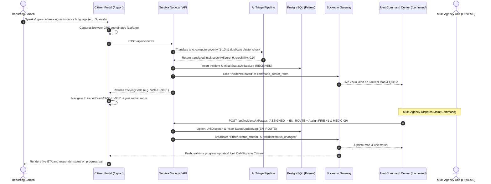

# Survixa: AI-Powered Unified Disaster Response Platform
### Common Operating Picture, Multi-Agency Coordination & Citizen Feedback Loop

---

## 🏛️ Executive Architectural Overview

During catastrophic crises (floods, earthquakes, wildfires, mass-casualty events), response efforts frequently break down not from a lack of physical resources, but from **technical and institutional silos**:
* **Agency Silos**: Fire Departments, Emergency Medical Services (EMS), Tactical Police, and Humanitarian NGOs operate isolated CAD (Computer Aided Dispatch) databases that cannot interoperate or share telemetry.
* **Citizen Information Void**: Citizens who report life-or-death emergencies are left in the dark after dialing emergency numbers, leading to panic, repeated calls, and clogged dispatch lines.
* **Language & Triage Friction**: Distress calls in non-native languages suffer catastrophic delays during manual translation and urgency estimation.

**Survixa** is architected to eliminate these bottlenecks through a **Unified Full-Stack Architecture** combining **Next.js (App Router)**, **Node.js**, **Socket.io**, and **PostgreSQL with Prisma ORM**.

---

## 📐 Unified System Topology

```
+-----------------------------------------------------------------------------------+
|                               SURVIXA PLATFORM TOPOLOGY                           |
+-----------------------------------------------------------------------------------+
|                                                                                   |
|   +-----------------------+              +------------------------------------+   |
|   |    Citizen Portal     |              |     Command Center Dashboard       |   |
|   |       (/report)       |              |             (/command)             |   |
|   |                       |              |                                    |   |
|   | * Multilingual Speech |              | * Multi-Agency Common Picture      |   |
|   | * Auto-GPS Telemetry  |              | * AI Severity Triage (1-10)        |   |
|   | * Live Feedback Loop  |              | * Duplicate Clustering             |   |
|   +-----------+-----------+              | * Unified Multi-Agency Dispatch    |   |
|               |                          +-----------------+------------------+   |
|               | HTTP POST / WebSocket                      | WebSocket            |
|               v                                            v                      |
|   +---------------------------------------------------------------------------+   |
|   |                  Node.js Unified Server (src/server/index.ts)             |   |
|   |                                                                           |   |
|   |   +--------------------------+       +--------------------------------+   |   |
|   |   |    Next.js App Router    |       |       Socket.io Gateway        |   |   |
|   |   |   * Route Handlers       |       |  * command_center_room         |   |   |
|   |   |   * SSR & Client Pages   |       |  * citizen:<trackingCode>      |   |   |
|   |   |   * AI Triage Pipeline   |       |  * agency:<FIRE|MED|POLICE|NGO>|   |   |
|   |   +------------+-------------+       +---------------+----------------+   |   |
|   +----------------|-------------------------------------|--------------------+   |
|                    v                                     v                        |
|   +---------------------------------------------------------------------------+   |
|   |                           Prisma ORM Layer                                |   |
|   +---------------------------------------------------------------------------+   |
|                                        |                                          |
|                                        v                                          |
|   +---------------------------------------------------------------------------+   |
|   |                      PostgreSQL Relational Database                       |   |
|   |  - incidents (Spatial & Severity Indexes)                                 |   |
|   |  - rescue_units (Live GPS & Multi-Agency Readiness)                       |   |
|   |  - unit_dispatches (Joint Task Force Inter-Agency Mappings)               |   |
|   |  - status_update_logs (Citizen Feedback Loop Audit Trail)                 |   |
|   +---------------------------------------------------------------------------+   |
+-----------------------------------------------------------------------------------+
```

---

## 📁 Repository Directory Structure

```
d:\Survixa/
├── .env.example                       # Environment configuration template
├── .gitignore                         # Git exclusion rules
├── next.config.ts                     # Next.js optimization configuration
├── package.json                       # Core dependencies & deployment scripts
├── postcss.config.mjs                 # PostCSS configuration for Tailwind CSS
├── tailwind.config.ts                 # Custom disaster & agency color palettes
├── tsconfig.json                      # Strict TypeScript compiler rules & path aliases
├── README.md                          # Architectural Blueprint & operational guide
├── prisma/
│   ├── schema.prisma                  # Prisma ORM schema (Incident, RescueUnit, StatusUpdateLog)
│   └── seed.ts                        # Multi-agency & multilingual disaster seed data
└── src/
    ├── app/
    │   ├── layout.tsx                 # Root application shell (dark tactical theme)
    │   ├── page.tsx                   # Master gateway routing to Citizen vs Command views
    │   ├── globals.css                # Radar beacons, pulse keyframes, tactical scrollbars
    │   ├── (citizen)/
    │   │   └── report/
    │   │       ├── page.tsx           # Citizen Emergency Portal
    │   │       └── track/[id]/page.tsx# Citizen Live Tracking Feedback Loop
    │   ├── (dashboard)/
    │   │   └── command/
    │   │       ├── page.tsx           # Common Operating Picture & Situational Dashboard
    │   │       └── dispatch/page.tsx  # Dedicated Multi-Agency Task Force Dispatch Desk
    │   └── api/
    │       ├── incidents/
    │       │   ├── route.ts           # Ingest citizen reports with AI triage & list incidents
    │       │   └── [id]/
    │       │       ├── route.ts       # Query incident by ID or citizen tracking code
    │       │       └── status/route.ts# Advance status, dispatch units & stream to feedback loop
    │       ├── units/
    │       │   ├── route.ts           # List & register multi-agency rescue units
    │       │   └── [id]/gps/route.ts  # Ingest live high-frequency GPS telemetry
    │       ├── ai/
    │       │   └── triage/route.ts    # Standalone multilingual AI triage endpoint
    │       └── socket/
    │           └── route.ts           # Socket.io gateway health check
    ├── components/
    │   ├── citizen/
    │   │   ├── EmergencyReportForm.tsx # Audio transcription, GPS capture, multilingual form
    │   │   └── LiveCitizenFeedbackLoop.tsx # 5-stage visual progress loop & unit ETA telemetry
    │   └── command/
    │       ├── CommandHeader.tsx      # Silo-breaker agency switcher & critical counter HUD
    │       ├── IncidentQueue.tsx      # Triage list sorted by Severity (1-10) with AI badges
    │       ├── LiveIncidentMap.tsx    # Interactive tactical situational map with radar pulses
    │       ├── MultiAgencyUnitList.tsx# Roster across Fire, Medical, Police, NGO
    │       └── DispatchModal.tsx      # Multi-agency joint dispatch modal
    ├── lib/
    │   ├── ai-triage.ts               # NLP translation, severity grading, Haversine deduplication
    │   ├── prisma.ts                  # Safe Prisma client singleton
    │   ├── socket-client.ts           # Typed client-side Socket.io connector
    │   └── utils.ts                   # Severity color badges, agency formatting, cn utility
    ├── server/
    │   ├── index.ts                   # Custom Node.js HTTP server embedding Next.js & Socket.io
    │   └── socket.ts                  # Socket.io room management & broadcast bus
    └── types/
        ├── index.ts                   # Core domain types & interfaces
        └── socket-events.ts           # Strongly typed WebSocket event contracts
```

---

## 🗄️ Database Architecture (`prisma/schema.prisma`)

The Prisma schema is structured specifically to **break agency silos** and provide **transparent citizen feedback**:

### 1. `Incident` Model
* **Multilingual Input & AI Normalization**:
  * `originalLanguage`: Stores ISO language code (e.g. `es`, `hi`, `uk`, `ar`, `en`).
  * `rawContent`: Unmodified citizen submission (text or audio transcription).
  * `translatedText`: AI-standardized operational English for cross-agency response teams.
* **Geospatial Coordinates**:
  * `latitude` / `longitude`: High-precision GPS coordinates with spatial database index `@@index([latitude, longitude])`.
  * `locationName`: Reverse-geocoded landmark or road intersection.
* **AI Assessment Metrics**:
  * `severityScore`: Strict normalized urgency rating on a scale of **1 to 10**.
  * `credibilityScore`: Confidence score (**0.00 to 1.00**) derived from NLP corroboration, caller telemetry, and sensor data.
  * `duplicateCount`: Tracks citizen reports clustered into this single ground-truth event.
* **Lifecycle State**:
  * `status`: Enum containing **`RECEIVED`**, **`VERIFIED`**, **`ASSIGNED`**, **`EN_ROUTE`**, **`RESOLVED`**.
* **Deduplication Self-Relation**:
  * `parentIncidentId` / `clusteredReports`: Automatically links multiple reports of the same crisis within a 500m radius to eliminate duplicate dispatches.

### 2. `RescueUnit` Model
* **Inter-Agency Categorization**:
  * `agencyType`: Enum covering **`FIRE`**, **`MEDICAL`**, **`POLICE`**, **`NGO`**, **`COAST_GUARD`**, **`CIVIL_DEFENSE`**.
* **Live GPS Telemetry**:
  * `latitude`, `longitude`, `altitude`, `speed`, `heading`, and `lastGpsUpdate`.
* **Readiness Tracking**:
  * `availability`: Enum (`AVAILABLE`, `DISPATCHED`, `ON_SCENE`, `RETURNING`, `STANDBY`, `OFFLINE`).
  * `capabilities`: String array of specialized equipment (e.g., `["Hydraulic Extrication", "Water Rescue"]`).

### 3. `UnitDispatch` Model
* **Breaking Institutional Silos**:
  * Join model enabling **joint task forces** where a single incident can simultaneously deploy units across multiple distinct agencies (e.g., Fire suppression + EMS medical triage + Police perimeter + Red Cross humanitarian shelter).

### 4. `StatusUpdateLog` Model (Citizen Feedback Loop)
* **Closing the Communication Loop**:
  * Links to `Incident` and optionally to `RescueUnit`.
  * `status`: Mirrors lifecycle transitions.
  * `message`: Human-readable, transparent update streamed directly to the citizen's device (e.g., *"Unit FIRE-ENGINE-41 has been dispatched. Estimated arrival in 4 minutes."*).
  * `internalNotes`: Restricted tactical command notes.
  * `visibility`: `PUBLIC` vs `INTERNAL_CONFIDENTIAL`.

---

## 🔄 The Citizen Feedback Loop (Sequence of Operations)



---

## 🚀 Quickstart & Operational Commands

### 1. Prerequisites
* Node.js v20+ / v22+
* PostgreSQL instance running locally or via Docker

### 2. Configure Environment
```bash
cp .env.example .env
# Edit DATABASE_URL with your PostgreSQL connection string
```

### 3. Generate Prisma Client & Run Migrations
```bash
npm run prisma:generate
npm run prisma:migrate
npm run prisma:seed
```

### 4. Start Unified Development Server
```bash
# Boots Next.js + Socket.io + Node.js HTTP Server in one unified process
npm run dev
```

### 5. Access Platforms
* **Gateway Portal**: [http://localhost:3000](http://localhost:3000)
* **Citizen Emergency Portal**: [http://localhost:3000/report](http://localhost:3000/report)
* **Joint Command Center**: [http://localhost:3000/command](http://localhost:3000/command)
* **Socket.io Endpoint**: `ws://localhost:3000/socket.io`
